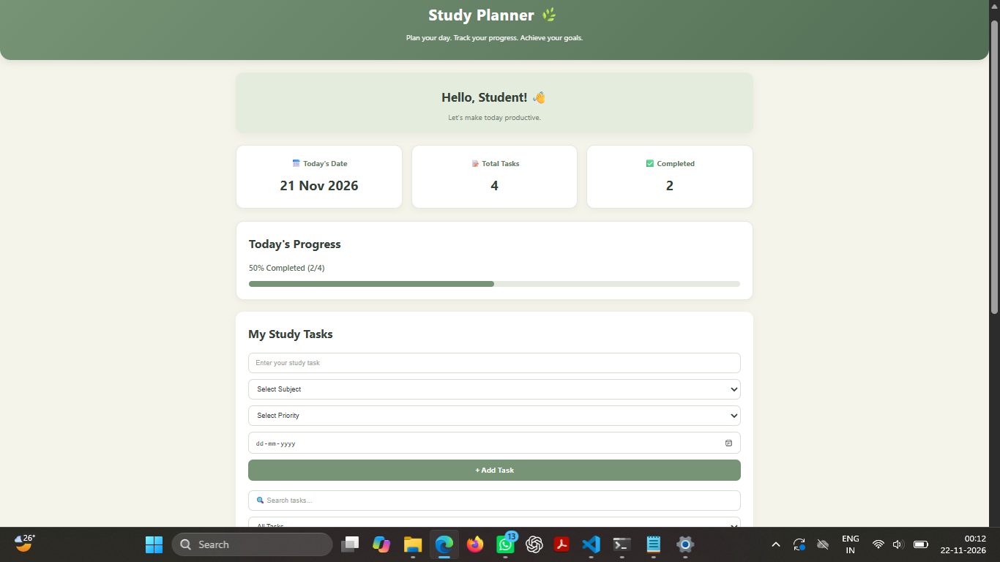

🌿 STUDENT STUDY PLANNER

A simple and user-friendly Study Planner Web Application designed to help students organize their daily study tasks and track their progress.

✨ Features

- Add new study tasks
- Edit and update existing tasks
- Delete unwanted tasks
- Mark tasks as completed or pending
- Set task priorities (High, Medium, Low)
- Add subject names and due dates
- Search tasks
- Filter tasks by status and priority
- Track study progress with a progress bar
- Save tasks using Browser Local Storage
- Responsive and user-friendly design

🛠️ Technologies Used

- HTML5
- CSS3
- JavaScript
- Browser Local Storage

📂 Project Structure

```text
Student-Study-Planner/
│
├── index.html
├── style.css
├── script.js
└── README.md
```

🚀 How to Run

1. Download or clone this repository.
2. Open the project folder.
3. Open `index.html` in your browser.
4. Start adding your study tasks!

🎯 Project Purpose

The purpose of this project is to help students manage their study schedules, organize daily tasks, set priorities, and monitor their progress.

👩‍💻 Developer

Developed as a personal web development project.

---

**Stay organized. Stay focused. Keep learning!** 🌿

📸 Project Preview

# Dashboard


# Task Management
